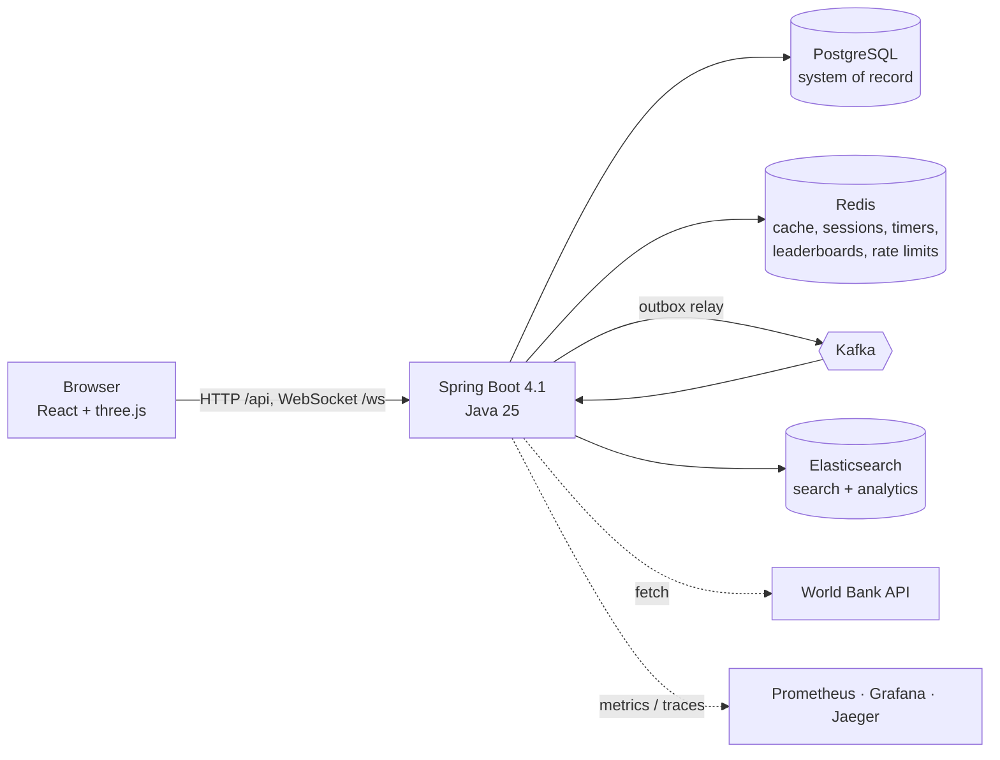

# World Explorer

World Explorer is an interactive 3D atlas and geography learning platform. Its globe connects
country profiles and World Bank data with historical comparisons, guided lessons and quizzes.
The full-stack deployment adds accounts, multiplayer, a personal atlas and a data platform.

**[Live historical demo](https://lorenzo689.github.io/World-Atlas/)** ·
[Engineering case study](docs/PORTFOLIO.md) · [Deployment guide](docs/DEPLOY.md) ·
[Security audit](docs/SECURITY-AUDIT.md)

The **historical timeline** covers 1886–2019 with dated boundaries and available flags. Two years
can be compared side by side, including geometric border and area changes. Guided lessons and
source-dated conflict learning points add context. See [historical data and licensing](docs/HISTORY.md).

The present-day globe loads [higher-detail borders, rivers, lakes, administrative boundaries,
place labels and NASA image tiles](docs/MAP-DETAIL.md) for the visible area as the camera zooms in.
Historical views retain their own dated CShapes boundaries.

The GitHub Pages demo is a static build without login or backend services. On a fresh visit it
opens the 1989/1991 comparison. The complete application requires a separate
[Spring Boot deployment](docs/DEPLOY.md).

## Features

The full-stack deployment includes:

- **Geo quiz** – find countries on the globe, capitals, flags, population duels; daily challenge; leaderboards;
  **duels** (share a link, everybody plays the same questions once)
- **Multiplayer** – live rooms over WebSocket, quick-match, chat, live answer markers on the globe
- **Data platform** – World Bank indicators ingested through Kafka into PostgreSQL; rankings, trends,
  distributions, correlations, a **1990–2025 time slider** on the globe
- **Personal atlas** – favourites, **travel map** (visited / lived / wishlist painted on the globe, shareable
  image), full-text searchable notes, shareable globe views
- **Achievements** – 18 badges, daily streak, per-region knowledge; pushed live over WebSocket
- **Compare** two countries on the globe and across indicators
- **German / English** UI incl. localised country names, **PWA** (installable, offline shell), keyboard and
  screen-reader support
- **Admin console** – system overview, ingestion, users and roles

## Tech stack

**Frontend:** React 19 · TypeScript · Vite · Tailwind CSS v4 · shadcn/ui (Radix) · Three.js (own globe scene) · Recharts · React Router · STOMP
**Backend:** Spring Boot 4.1 · Java 25 · PostgreSQL · Redis · Kafka · Elasticsearch · Flyway · JWT + HttpOnly refresh cookie · WebSocket · Testcontainers · OpenTelemetry



## Full stack in three commands

```bash
docker compose up -d                    # PostgreSQL (5433), Redis, Kafka, Elasticsearch
(cd backend && ./mvnw spring-boot:run)  # API on :8080
(cd frontend && npm ci && npm run dev)  # frontend on :5173, proxies /api and /ws
```

How the backend works, module by module, with the main request flows: [docs/BACKEND-GUIDE.md](docs/BACKEND-GUIDE.md) (German).
Going public (HTTPS, one server): [docs/DEPLOY.md](docs/DEPLOY.md) (German).
Without the backend the globe and country pages still work (data comes straight from the World Bank).

Optional tooling: `docker compose --profile monitoring up -d` (Prometheus, Grafana dashboard, Jaeger),
`--profile tools` (Kafka UI, Mailpit). In development the e-mails (verification, password reset) are kept in a
dev mailbox: `GET /api/dev/mails`.

## Tests

The admin console includes an event delivery view. It shows queued and exhausted transactional
outbox events; after fixing the underlying error, an admin can retry one exhausted event.
Prometheus exposes `outbox_pending` and `outbox_failed` gauges. Kafka consumer failures are
parked on per-topic `.dlt` topics, visible in Kafka UI.

```bash
(cd frontend && npm test)                       # frontend unit/component tests
(cd backend && ./mvnw verify)                   # backend integration tests (Docker)
(cd frontend && npm run build && npm run e2e)  # browser end-to-end test
docker run --rm -i -e BASE_URL=http://host.docker.internal:8080 grafana/k6:1.3.0 run - < loadtest/quiz.js
```

## Frontend development

```bash
cd frontend
npm ci
npm run dev        # http://localhost:5173
npm run build      # type-check + production build into dist/
npm run preview    # serve the production build
npm test           # vitest
npm run data       # regenerate public/data + public/flags (see below)
npm run icons      # regenerate the PWA icons from public/favicon.svg
```

## Atlas interface

| Area | Notes |
| --- | --- |
| Globe | NASA Blue Marble texture, bump + ocean specular, atmosphere, 1:50m borders, hover highlight and animated fly-to framed by country size. The globe does not rotate automatically. |
| Modes | **Satellite**, **Political** (regional palette), **Data** (quantile choropleth of 9 World Bank indicators; year shown on hover). |
| Search | ARIA combobox, diacritic-insensitive, matches names, capitals and ISO codes. `/` or `Ctrl/Cmd+K` focuses it. |
| Preview | Desktop side panel / mobile bottom sheet (drag or tap handle) with flag, capital, population, area, currency, languages, neighbours. The globe re-centres the country in the free area beside the panel. |
| Country pages | `/countries/:code/:tab?` (alpha-2 or alpha-3, canonicalised to alpha-3). Tabs: overview, population, economy, geography. |
| State | Zustand store keeps mode, data metric, selection and last camera pose, so leaving to a country page and coming back restores the view. |
| SEO | Per-page `<title>`, description, canonical, Open Graph and JSON-LD; `sitemap.xml` and `robots.txt` are generated. |

## Data and sources

Missing values render as `—` or an explicit empty state. Charts show their data years and sources.

- **Statistics**: [World Bank Open Data](https://data.worldbank.org) API (CC BY 4.0), fetched live in the browser and cached per session.
- **Country metadata**: [mledoze/countries](https://github.com/mledoze/countries) (ODbL), snapshotted in `frontend/scripts/source/countries.json`.
  (REST Countries v3.1 is deprecated and v5 needs an API key, so it isn't used.)
- **Boundaries**: Natural Earth 1:50m world view and 1:10m close-zoom tiles via `world-atlas` (public domain).
- **Flags**: `flag-icons` (MIT), copied to `frontend/public/flags`.
- **Descriptions**: Wikipedia REST summary API (CC BY-SA), attributed on the page.
- **Textures**: NASA Blue Marble Next Generation January 2004 with topography and bathymetry. From `frontend/`, `node scripts/optimize-textures.mjs` checks the pinned original and writes 4K/2K base maps plus close-zoom WebP tiles.

From `frontend/`, `npm run data` rebuilds `public/data/{countries,boundaries}.json` (boundaries are a simplified TopoJSON topology), the pre-triangulated globe caps `public/data/geometry.{bin,json}`, `public/flags`, `sitemap.xml` and `robots.txt`. Serve `*.bin` with compression enabled.

## Structure

```
frontend/
 src/
  components/ globe/ (GlobeView, controls, preview, bottom sheet)
              country/ (tabs, map, locator globe, flag)
              charts/ ui/ layout/
  hooks/      data loading (countries, boundaries, indicators), media queries, document meta
  lib/        World Bank + Wikipedia clients, formatting, search, geo framing, colour scales,
              globeScene (three.js scene, on-demand render loop, quality governor), globeLayers (merged map layers, picking), perf (?debug=1 probe)
  store/      zustand explorer state
  pages/      ExplorerPage, CountryPage, Quiz, Multiplayer, Leaderboard, Atlas, Data, Compare, Achievements, Admin ...
  i18n/       en.ts / de.ts dictionaries, useT(), localised country names (Intl.DisplayNames)
```

## Known limitations

The [security audit](docs/SECURITY-AUDIT.md) records the current security controls, test evidence and deployment limits.

- SEO metadata is set client-side (SPA); crawlers that don't run JS will see the generic shell. Pre-rendering would be the next step.
- `sitemap.xml` uses a placeholder origin (`world-explorer.example`); edit `frontend/scripts/build-data.mjs` before deploying.
- The service worker caches static assets only; API data, quiz sessions and WebSockets always need the network.
- 14 small territories have no polygon in the 1:50m dataset (e.g. Gibraltar, Réunion). They are searchable and the camera flies to their coordinates, but no shape is highlighted.
- Country borders follow the Natural Earth dataset and carry no political endorsement.
- The WebGL chunk is large (~1.9 MB, three.js); it is lazy-loaded so country pages stay light.
